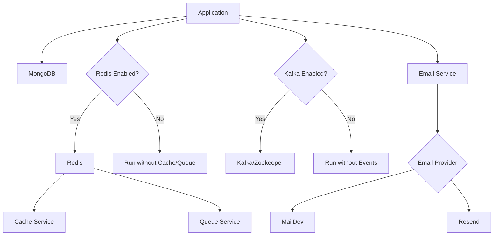

# Infrastructure Overview

This document provides an overview of all infrastructure components and how they work together.

## 🏗️ Components

The application uses the following infrastructure services:

| Service       | Purpose               | Technology       | Port      | Required         |
| ------------- | --------------------- | ---------------- | --------- | ---------------- |
| **MongoDB**   | Primary database      | MongoDB 7.0      | 27017     | Yes              |
| **Redis**     | Cache & Queue backend | Redis 7          | 6379      | No\*             |
| **Kafka**     | Event streaming       | Apache Kafka 7.5 | 9092      | No\*             |
| **Zookeeper** | Kafka coordination    | Apache Zookeeper | 2181      | If Kafka enabled |
| **MailDev**   | Email testing (dev)   | MailDev          | 1025/1080 | No               |

_\* Can be disabled via feature toggles with graceful degradation_

## 📊 Architecture Diagram

```
┌─────────────────────────────────────────────────────────────────┐
│                        Application Layer                         │
│                      Express.js + TypeScript                     │
└────────┬──────────────┬──────────────┬──────────────┬───────────┘
         │              │              │              │
         ▼              ▼              ▼              ▼
    ┌────────┐    ┌────────┐    ┌────────┐    ┌────────┐
    │MongoDB │    │ Redis  │    │ Kafka  │    │ Email  │
    │ (Data) │    │(Cache) │    │(Events)│    │Service │
    └────────┘    └────────┘    └────────┘    └────────┘
         │              │              │              │
         │              └──────┬───────┘              │
         │                     │                      │
         ▼                     ▼                      ▼
    ┌────────┐         ┌────────────┐         ┌──────────┐
    │Mongoose│         │   BullMQ   │         │MailDev/  │
    │  ODM   │         │  (Queue)   │         │ Resend   │
    └────────┘         └────────────┘         └──────────┘
```

## 🗂️ Data Flow

### Write Operations

```
Client Request → Controller → Service → Repository → MongoDB
                                  ↓
                          ┌───────┴───────┐
                          ▼               ▼
                       Kafka           Queue
                      (Events)        (Jobs)
```

### Read Operations

```
Client Request → Controller → Service → Repository
                                          ↓
                                    Check Cache
                                          ↓
                                  Cache Hit? → Return
                                          ↓ No
                                      MongoDB
                                          ↓
                                     Cache Result
                                          ↓
                                       Return
```

## 📚 Detailed Documentation

### Core Services

- **[Database (MongoDB)](./DATABASE.md)** - Data persistence, models, queries
- Redis, BullMQ, Kafka, and email source are described in this overview; separate service guides are not present.

### Service Dependencies



## 🚀 Starting Services

### All Services

```bash
make infra-up
# or
docker-compose up -d
```

### Individual Services

```bash
make db-up        # MongoDB only
make redis-up     # Redis only
make kafka-up     # Kafka + Zookeeper
```

### Verify Services

```bash
docker-compose ps
```

All services should show "Up" or "healthy" status.

## 🔧 Configuration

Each service can be configured via environment variables. See [Configuration Reference](../getting-started/CONFIGURATION.md) for details.

### Feature Toggles

```bash
# Enable/disable services
REDIS_ENABLED=true       # Cache & Queues
QUEUE_ENABLED=true       # Background jobs
KAFKA_ENABLED=true       # Event streaming
```

### Graceful Degradation

The application handles missing services gracefully:

- **No Redis**: Runs without caching and queueing
- **No Kafka**: Runs without event publishing
- **MongoDB Required**: Application won't start without database

## 🔍 Service Health Checks

### MongoDB

```bash
docker exec -it backend-mongodb mongosh --eval "db.adminCommand('ping')"
```

### Redis

```bash
docker exec -it backend-redis redis-cli ping
```

### Kafka

```bash
docker exec -it backend-kafka kafka-broker-api-versions --bootstrap-server localhost:9092
```

## 🖥️ Management UIs

| Service             | URL                   | Credentials |
| ------------------- | --------------------- | ----------- |
| **Mongo Express**   | http://localhost:8081 | None        |
| **Redis Commander** | http://localhost:8082 | None        |
| **Kafka UI**        | http://localhost:8083 | None        |
| **MailDev**         | http://localhost:1080 | None        |

## 📊 Resource Usage

Typical resource consumption:

| Service         | Memory | CPU    | Disk     |
| --------------- | ------ | ------ | -------- |
| **MongoDB**     | ~200MB | 5-10%  | Variable |
| **Redis**       | ~50MB  | 1-5%   | ~100MB   |
| **Kafka**       | ~300MB | 10-15% | Variable |
| **Zookeeper**   | ~100MB | 5%     | ~100MB   |
| **Application** | ~150MB | 10-20% | Minimal  |

**Total**: ~800MB RAM minimum for all services

## 🔐 Security

### Development

- The local Compose configuration does not set service authentication
- Ports are published on the host; actual reachability depends on host networking and firewall rules
- MailDev for email testing

### Production Recommendations

- Enable authentication on all services
- Use TLS/SSL for connections
- Restrict network access
- Use secrets management (AWS Secrets Manager, Vault)
- Regular security updates

See [Security Guide](../guides/SECURITY.md) for details.

## 📈 Scaling

The repository includes optional Redis, BullMQ, and Kafka integrations plus configurable MongoDB pool and worker-concurrency settings. Their presence does not establish shared-state behavior, distributed job guarantees, or horizontal scalability. No multi-instance deployment is configured or verified here.

### Configuration examples

```bash
# MongoDB connections
maxPoolSize: 10  → 50

# Queue workers
QUEUE_WORKER_CONCURRENCY=5  → 20

# Redis connections
(handled automatically)
```

## 🔄 Backup & Recovery

### MongoDB Backup

```bash
# Backup
docker exec backend-mongodb mongodump --out /backup

# Restore
docker exec backend-mongodb mongorestore /backup
```

### Redis Backup

```bash
# Redis persists to disk automatically (AOF + RDB)
# Backup files in Docker volume: redis_data
```

### Kafka

Kafka retains messages based on retention policy (default: 168 hours).

## 🐛 Troubleshooting

### Service Won't Start

```bash
# Check logs
docker-compose logs [service-name]

# Restart service
docker-compose restart [service-name]

# Remove and recreate
docker-compose down
docker-compose up -d
```

### Connection Refused

- Ensure service is running: `docker-compose ps`
- Check port conflicts: `lsof -i :PORT`
- Verify environment variables

### Performance Issues

- Check resource usage: `docker stats`
- Review connection pool settings
- Check for slow queries (MongoDB)
- Monitor cache hit rate (Redis)

## 📖 Further Reading

- [Database Guide](./DATABASE.md) - MongoDB setup and patterns
- [Architecture Overview](../architecture/ARCHITECTURE.md) - Source structure and integration boundaries

---

**Next**: [Database Guide](./DATABASE.md) →
